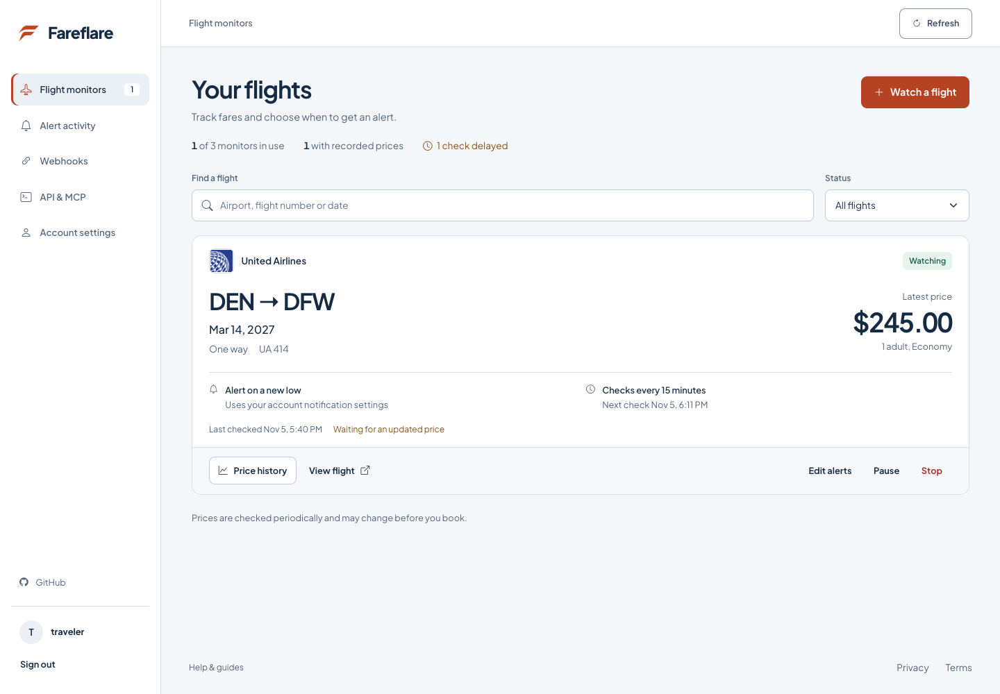

# Fareflare

Open-source flight price monitoring with Telegram alerts, webhooks, an HTTP API, and MCP.

Paste a supported Google Flights link, choose an alert rule, and Fareflare records
prices as it checks. See the latest fare, previous observations, and collection
status in one dashboard. Connect Telegram or a verified webhook to receive alerts
when a price meets your rule.

[Open Fareflare](https://8jq9j5zhif.execute-api.us-east-1.amazonaws.com) ·
[Local setup](docs/FAREFLARE.md) · [Documentation](docs/README.md) ·
[Contribute](CONTRIBUTING.md)



## What it does

- Tracks selected itineraries and supported route searches without a customer
  Google login or a paid flight-data API.
- Explores recorded prices by date range, with scoped comparisons, visible gaps,
  and CSV exports.
- Finds loaded monitors by airport, flight number, date, or status; loads further
  pages when available.
- Supports new-low, target-price, and optional rebound alerts, with pause and mute controls.
- Provides the same monitors through the dashboard, REST API, and remote MCP.
- Delivers alerts through Telegram or signed HTTPS webhooks with durable retries.
- Shares collection for equivalent searches while keeping accounts and alert rules private.

History comparisons use the observations loaded in the selected range, not every
fare ever offered. CSV files include UTC timestamps, currency, and integer minor
units; for example, `19100` USD means $191.00. See the
[dashboard guide](docs/FAREFLARE.md#use-the-dashboard) for scope and export details.

The hosted service is **free and invite-only** while capacity is being measured.
Billing is disabled. Self-hosting uses your own infrastructure and can incur costs.
Prices are sampled periodically: Fareflare cannot guarantee the cheapest fare on
the market or detect a drop that begins and ends between checks.

## Run locally

Requirements: Python 3.12, Node.js 24, and npm. No AWS account is needed for the
local dashboard, API, MCP, or automated tests.

```bash
git clone https://github.com/cxdima/fareflare.git
cd fareflare
python3.12 -m venv .venv
make install
make build
make invite
make serve
```

Open the signup URL saved in `.next/invitation.json`. The application runs at
`http://127.0.0.1:8001`, and local data stays in `.next/product.sqlite3`.
Save the recovery code shown at signup; account recovery does not use email.
Invitation files contain credentials and must stay private.

Live collection needs Chromium and a matching ChromeDriver. Run one bounded pass
in another terminal:

```bash
PYTHONPATH=src .venv/bin/python -m gfpt_next.product_cli worker --limit 5
```

The worker checks due monitors and processes alerts. Schedule it separately for
continuous monitoring. See the [setup guide](docs/FAREFLARE.md) for browser paths,
route-search configuration, and AWS deployment.

## Supported flights

| Input              | Current coverage                                                                                |
| ------------------ | ----------------------------------------------------------------------------------------------- |
| Selected itinerary | US-English economy, one or two adults, USD or JPY, nonstop one-way or fully selected round trip |
| Route search       | Exact airports and date, one way, nonstop, one adult, USD, US-English economy excluding Basic   |

Route searches are enabled on the hosted instance and opt-in when self-hosting.
Connections, flexible dates, nearby airports, other passenger types, and additional
cabins or markets require further collector validation. Unsupported inputs are
rejected explicitly. A recorded price can change before booking.

## Stack and structure

The Angular and Bootstrap frontend uses component classes, signals, and external
SCSS. A Python/FastAPI API serves the built website and account workflows. Browser
collection runs separately with Selenium and Chromium. SQLite supports local use;
AWS uses DynamoDB, separate API and worker Lambdas, and EventBridge.

| Path             | Purpose                                                                     |
| ---------------- | --------------------------------------------------------------------------- |
| `src/gfpt_next/` | Domain models, account services, API/MCP, collectors, persistence, delivery |
| `web/`           | Angular website, dashboard, and Playwright tests                            |
| `tests_next/`    | Backend behavior, security, integration, and collector fixtures             |
| `infra-next/`    | Terraform for the API, worker, storage, scheduling, and alarms              |
| `examples/`      | Synthetic demos and a signed webhook receiver example                       |
| `docs/`          | Setup, architecture, operations, and verification records                   |

Internal module and environment-variable names retain the `gfpt_next` prefix.
Use the default Makefile commands above for the account-based application.

## API and MCP

Create an API key in **API & MCP**. Send it in the `Authorization: Bearer` header;
never put it in a URL. The application serves `/docs` and `/openapi.json` for the
HTTP API. The remote MCP endpoint is `/mcp`, with OAuth/PKCE or an API key for
clients that support custom headers. See [integration details](docs/NEXT.md).

## Contributing

Bug reports, collector fixtures, accessibility improvements, and documentation
changes are welcome. Read [CONTRIBUTING.md](CONTRIBUTING.md) for setup, tests, and
pull request guidance. Report vulnerabilities through the private channel in
[SECURITY.md](SECURITY.md).

```bash
make check
npm --prefix web run format:check
npm --prefix web run build
npm --prefix web test
```

Fareflare is [MIT licensed](LICENSE). Dependencies and airline trademarks retain
their respective licenses and ownership. Fareflare is not affiliated with Google
or any airline.
