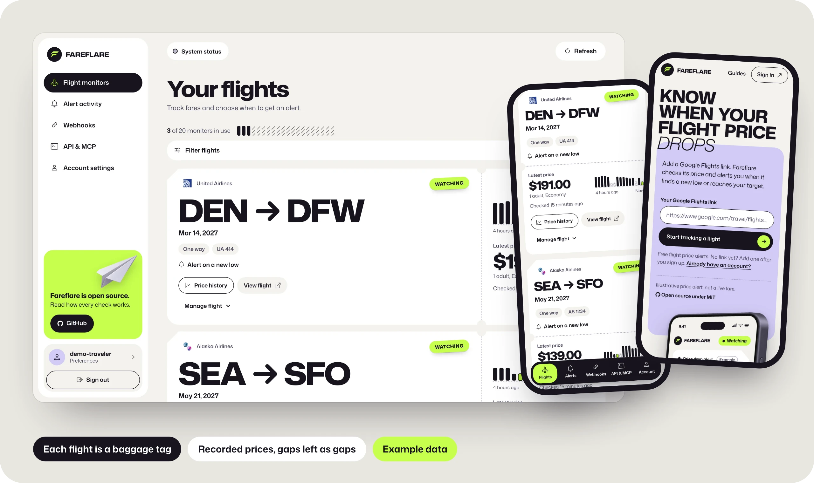
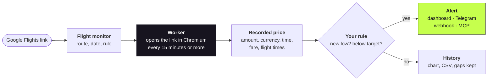
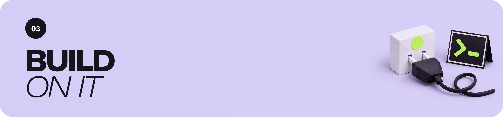
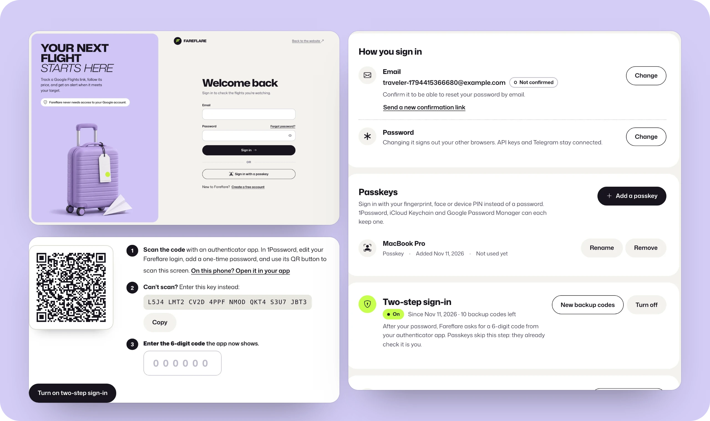

<div align="center">


<br>

&nbsp;
<a href="#architecture"></a>
<a href="#architecture"></a>
<a href="#architecture"></a>
<a href="#architecture"></a>
<a href="#architecture"></a>
<br>
&nbsp;
<a href="#sign-in-and-account-security"></a>
<a href="#sign-in-and-account-security"></a>
<a href="#sign-in-and-account-security"></a>
<br>
&nbsp;
<a href="#02--alerts"></a>
<a href="#03--developers"></a>
<a href="#03--developers"></a>
<a href="#03--developers"></a>
<br>
&nbsp;
<a href="#04--run-it-yourself"></a>
<a href="#04--run-it-yourself"></a>
<a href="#04--run-it-yourself"></a>
<a href="#04--run-it-yourself"></a>
<br>
&nbsp;
<a href="https://github.com/cxdima/fareflare/actions/workflows/ci.yml"></a>
<a href="#testing"></a>
<a href="#testing"></a>
<a href="LICENSE"></a>

**[Open Fareflare](https://fareflare.dev) · [How it works](#01--how-it-works) · [Alerts](#02--alerts) · [Developers](#03--developers) · [Architecture](#architecture) · [Sign-in](#sign-in-and-account-security) · [Run it yourself](#04--run-it-yourself)**

</div>

<br>

Fareflare watches the price of a flight you picked. Paste a Google Flights link,
choose when you want to hear about it, and Fareflare records the price on every
check and tells you when it reaches a new low or drops under your target. The same
flights are reachable from the website, a Telegram bot, a REST API, signed webhooks
and MCP, so an AI assistant can work with them too.

- **No Google account and no paid flight-data API.** Fareflare reads the public price
  of the link you paste, with its own browser.
- **Recorded, never predicted.** Every price carries the time it was seen, and a check
  that recorded nothing stays a gap instead of being filled in.
- **Free and open.** The hosted service at [fareflare.dev](https://fareflare.dev) is
  free with open sign-up (20 flights per account); the code is MIT and runs on your
  own AWS account.

> [!NOTE]
> Fareflare checks prices periodically, so a fare can change between checks, and it
> cannot promise the cheapest fare on the market. It is not affiliated with Google or
> any airline. Screens in this README use example data.

<br>

## Contents

| | |
|---|---|
| **Use it** | [How it works](#01--how-it-works) · [Supported flights](#supported-flights) · [Alerts](#02--alerts) · [Sign-in and security](#sign-in-and-account-security) |
| **Build on it** | [REST API](#rest-api) · [Webhooks](#webhooks) · [MCP](#mcp) |
| **Under the hood** | [Architecture](#architecture) · [Who owns what](#who-owns-what) · [Repository map](#repository-map) |
| **Operate** | [Run locally](#run-locally) · [Configuration](#configuration) · [Deploy to AWS](#deploy-to-aws) · [Testing](#testing) · [Further reading](#further-reading) |

<br>



<br>


## 01 · How it works



1. **Add your flight.** Paste a selected itinerary or a supported route search from
   Google Flights. Fareflare decodes it and says at once whether it can watch it.
2. **Choose when to hear about it.** A new observed low, or a price under your target,
   with an optional alert when it rises again, a minimum drop, quiet hours and pause.
3. **Review the price.** Every check is kept with its time. The flights page shows a
   strip of recent prices on each tag; the history view adds date ranges, comparisons
   and CSV export. When you are ready, the tag links back to the flight to book it.

Equivalent searches share one collection while accounts, rules and alerts stay
private. A failed check is one plain sentence in the dashboard; technical detail is
an opt-in for developers.

### Supported flights

| Input | Current coverage |
|---|---|
| Selected itinerary | US-English economy, one or two adults, USD or JPY, nonstop one-way or a fully selected round trip |
| Route search | Exact airports and date, one way, nonstop, one adult, USD, US-English economy excluding Basic |

Route searches are on at fareflare.dev and opt-in when self-hosting. Connections,
flexible dates, nearby airports, other passenger types, cabins and markets need
further collector validation, and unsupported links are refused plainly.

<br>


## 02 · Alerts

| Where | What arrives |
|---|---|
| **Dashboard** | Alert activity with the price, what it is compared with, and delivery status; failed deliveries can be retried |
| **Telegram** | A message in your chat, in one of three built-in styles or [your own template](docs/ACCOUNT_PREFERENCES.md#message-styles-and-templates); silent delivery and [quiet hours](docs/ACCOUNT_PREFERENCES.md#quiet-hours); add flights, check prices and edit rules from the chat ([guide](docs/TELEGRAM.md)) |
| **Webhook** | A signed JSON event to your HTTPS endpoint, retried durably until it is accepted |
| **MCP / API** | The same alerts and history, for your own tools and assistants |

Alerts record what they were compared with (`previous.price_minor`,
`previous.low_minor`) and the flight times read with the price, so a message can say
`📉 New low! $246 (was $254, −$8 · −3%)` and `Mar 10 · 16:42 → 17:58`. Account
preferences hold the time zone, regional format and 12- or 24-hour clock; the fare
keeps its own currency.

<br>



## 03 · Developers

The website, the API and MCP use the same accounts and monitors.

### REST API

Create a key in **API & MCP**, send it as a bearer token (never in a URL), and use an
`Idempotency-Key` when you create something:

```sh
curl https://fareflare.dev/v1/monitors \
  -H "Authorization: Bearer $FAREFLARE_API_KEY" \
  -H "Idempotency-Key: my-first-flight" \
  -H "Content-Type: application/json" \
  -d '{"url":"YOUR_GOOGLE_FLIGHTS_LINK"}'
```

The application serves its OpenAPI document at `/openapi.json` and a script-free
reference at `/docs`. Keys are named, expire, can be revoked, and are stored only as
hashes.

### Webhooks

Register an HTTPS receiver in **Webhooks**, prove you own it with a signed
`webhook.verification` challenge, then route monitors to it. Events follow
[Standard Webhooks](https://www.standardwebhooks.com/): `webhook-id`,
`webhook-timestamp` and `webhook-signature` headers, a stable body and ID across
retries, and a 2xx once you have stored it. `make webhook-demo` runs a receiver
locally. Details: [integration guide](docs/INTEGRATIONS.md).

### MCP

The remote MCP endpoint is `/mcp`. Clients sign in with OAuth (PKCE and dynamic
registration, with a consent screen in the dashboard) or send an API key as a bearer
token. `make mcp` runs a stdio adapter for clients that prefer one. Connected
applications can be revoked in **Account settings → Connections**.

<br>

## Architecture


### Who owns what

| Concern | Owner | Where |
|---|---|---|
| Decoding a Google Flights link into a flight identity | Link importer | [`links.py`](src/fareflare/links.py) · [`search_links.py`](src/fareflare/search_links.py) |
| Reading the public price, with retries for Google's error page and browser crashes | Worker Lambda | [`public_browser.py`](src/fareflare/public_browser.py) · [`worker.py`](src/fareflare/worker.py) |
| Monitors, observations, rules and the event → outbox chain | Monitoring service | [`service.py`](src/fareflare/service.py) · [`outbox.py`](src/fareflare/outbox.py) |
| Accounts, sessions, passkeys, two-step codes, resets, API keys | Account service | [`accounts.py`](src/fareflare/accounts.py) · [`passkeys.py`](src/fareflare/passkeys.py) · [`totp.py`](src/fareflare/totp.py) |
| HTTP API, CSP, cookies, CSRF, the crawlable public pages | Portal | [`portal.py`](src/fareflare/portal.py) · [`site_content.py`](src/fareflare/site_content.py) |
| Telegram bot, OAuth and MCP | Integrations | [`telegram_bot.py`](src/fareflare/telegram_bot.py) · [`oauth.py`](src/fareflare/oauth.py) · [`hosted_mcp.py`](src/fareflare/hosted_mcp.py) |
| Storage: SQLite locally, one DynamoDB table in AWS | Store | [`store.py`](src/fareflare/store.py) |
| The website and workspace | Angular app | [`web/src/app`](web/src/app) |
| Infrastructure | Terraform | [`infra/`](infra) |

The HTTP server never launches a browser; collection runs only in the worker, under
a deployment-wide capacity limit that refuses extra targets rather than starting
unbounded work.

### Repository map

```text
fareflare/
├── src/fareflare/          Python package: domain, accounts, API, MCP, collectors, delivery
├── web/                    Angular 22 website and workspace, Playwright + axe tests
│   └── public/assets/      Artwork, scroll sequences and their generation prompts
├── tests/                  1,362 Python tests: behavior, security, integration, fixtures
├── infra/                  Terraform: API, worker, DynamoDB, schedule, alarms, domain, SES
├── examples/               Synthetic demo, signed-webhook receiver, release smoke test
├── docs/                   Setup, integrations, operations, design and verification records
│   └── readme/             This README's figures; node docs/readme/render.mjs redraws them
├── DESIGN.md               The design system
└── PRODUCT.md              What Fareflare is for, and what it must never claim
```

<br>

## Sign-in and account security



| | |
|---|---|
| **Passkeys** | Sign in with a fingerprint, face or device PIN, from 1Password, iCloud Keychain, Google Password Manager or a security key. The email field offers a saved passkey in its autofill list. Passkeys require user verification, so one replaces the password and the second step. |
| **Two-step sign-in** | A 6-digit code from an authenticator app after the password. Setup shows a QR code (1Password can scan it from the screen) and the key to type; the code field is marked `one-time-code` so 1Password fills it. Ten single-use backup codes come with it. |
| **Password reset** | A link sent through Amazon SES to a confirmed address. It works once, for 30 minutes, stops if the password changes first, asks for a code when two-step sign-in is on, and signs out other browsers. |
| **Sign out everywhere** | Revokes every session, API key, connected application and Telegram link, and signs this browser back in. |
| **Weak passwords and guessing** | New passwords must not be common, a run like `12345678`, built from the address, or found in Have I Been Pwned (only five characters of a hash leave the server). Wrong passwords and codes are capped per account, and account email has service-wide budgets. |
| **Admin panel** | Accounts, flights, checks and switches for the operator, opened only with a second factor and never by an API key. The role is granted only from the command line, and every action is recorded. See [Admin panel](docs/FAREFLARE.md#admin-panel). |
| **What is stored** | Passwords as scrypt hashes; sessions, API keys, reset links and backup codes as hashes; passkeys as public keys. Sessions are HttpOnly cookies with CSRF tokens, behind a strict content security policy. |

Report vulnerabilities privately through [SECURITY.md](SECURITY.md).

<br>


## 04 · Run it yourself

### Run locally

Requirements: Python 3.12, Node.js 24 and npm. No AWS account is needed for the
website, API, MCP or the tests.

```sh
git clone https://github.com/cxdima/fareflare.git
cd fareflare
python3.12 -m venv .venv
make install        # locked Python dependencies
make build          # the Angular website
make serve          # website, API and MCP at http://localhost:8001
```

Open `http://localhost:8001/register` and create an account. Data stays in
`.fareflare/product.sqlite3`, and account email (confirmation and reset links) is
written to `.fareflare/outbox/` instead of being sent. Use `localhost` rather than
`127.0.0.1` so passkeys work.

Live collection needs Chromium and a matching ChromeDriver. Run one bounded pass in
another terminal, and schedule it for continuous monitoring:

```sh
PYTHONPATH=src .venv/bin/python -m fareflare.product_cli worker --limit 5
```

`make demo` replays synthetic prices through the real pipeline without any network.
Run `make help` for every command.

### Configuration

<details>
<summary><b>Environment variables</b> (full list in <a href="docs/FAREFLARE.md#product-configuration">the setup guide</a>)</summary>

| Variable | Default | Meaning |
|---|---|---|
| `FAREFLARE_PUBLIC_URL` | required in Lambda | The exact HTTPS origin of the application |
| `FAREFLARE_REGISTRATION_MODE` | `open` | `open` lets anyone sign up; `closed` stops new accounts |
| `FAREFLARE_EMAIL` · `FAREFLARE_EMAIL_FROM` | `off` | `ses` sends account email through Amazon SES; `file` writes it to a folder |
| `FAREFLARE_SEARCH_ENABLED` | `false` | Admit the constrained route searches |
| `FAREFLARE_MONITOR_LIMIT` | `20` | Flights per account |
| `FAREFLARE_MIN_INTERVAL` | `900` | Minimum requested check interval, in seconds |
| `FAREFLARE_GLOBAL_TARGET_LIMIT` | `20` | Distinct targets the deployment will collect |
| `FAREFLARE_BILLING_ENABLED` | `false` | Must stay `false`: billing refuses to start until a payment integration exists |

</details>

### Deploy to AWS

[`infra/`](infra) provisions everything in your own account: two ECR repositories,
the API Lambda behind API Gateway on your domain (ACM and Route 53), the worker
Lambda on an EventBridge schedule, one DynamoDB table with point-in-time recovery,
CloudWatch alarms, and, with `email_enabled`, an SES identity with DKIM and a MAIL
FROM subdomain. Images are built for arm64 and pinned by digest. A new SES account
starts in the sandbox: request production access before relying on resets. The
[operations runbook](docs/OPERATIONS.md) covers configuration, releases, Telegram,
monitoring and rollback. Self-hosting uses your own infrastructure and can cost money.

<br>

## Testing

```sh
make check                          # compile, type-check, Ruff, 1,362 tests with coverage
npm --prefix web run format:check   # Prettier
npm --prefix web run build          # production build
npm --prefix web test               # 127 Playwright tests, with axe accessibility scans
```

The browser tests run against the real Python server and check the strict content
security policy, keyboard and screen-reader behavior, phone layouts, and that no
credential reaches browser storage. Passkey verification is tested with a software
authenticator that signs real WebAuthn responses. CI runs both suites and CodeQL on
every push, and dependency review on pull requests.

<br>

## Further reading

| Document | What is in it |
|---|---|
| [`docs/FAREFLARE.md`](docs/FAREFLARE.md) | Setup, supported flights, configuration and deployment prerequisites |
| [`docs/INTEGRATIONS.md`](docs/INTEGRATIONS.md) | REST API, webhooks and MCP contracts, signatures and delivery |
| [`docs/ACCOUNT_PREFERENCES.md`](docs/ACCOUNT_PREFERENCES.md) | Time zones, regional formats, Telegram styles, templates and quiet hours |
| [`docs/TELEGRAM.md`](docs/TELEGRAM.md) | Using the Telegram bot |
| [`docs/OPERATIONS.md`](docs/OPERATIONS.md) | Account email, Terraform, image releases, monitoring and recovery |
| [`DESIGN.md`](DESIGN.md) · [`docs/BRAND_ASSETS.md`](docs/BRAND_ASSETS.md) | The design system, and where every picture came from |
| [`CHANGELOG.md`](CHANGELOG.md) | What changed in each release, with upgrade notes |
| [`CONTRIBUTING.md`](CONTRIBUTING.md) · [`SECURITY.md`](SECURITY.md) | How to contribute, and how to report a vulnerability |

<br>

<div align="center">

<sub>Artwork generated with Higgsfield and composed in this repository; the figures are rendered from HTML in <code>docs/readme/src</code> (prompts in <code>docs/readme/src/art/PROMPTS.md</code>).<br>
Fareflare is <a href="LICENSE">MIT licensed</a>. Google Flights, airline names and marks belong to their owners; Fareflare is independent and not affiliated with or endorsed by them.</sub>

</div>
