# Google Flights and repository architecture review

Reviewed November 2, 2026. The objective is timely notification of a lower price
for the offer a customer actually wants, while preserving the family tracker and
its inexpensive collection path. The recommended direction is a modular Python
application with explicit quote identity, replaceable collectors and durable
alert delivery in the existing production AWS environment.

> Implementation updates and remaining release gates are tracked in
> [DEVELOPMENT_STATUS.md](DEVELOPMENT_STATUS.md); this review preserves the original findings.

## Google Flights page and data model

The public browser review covered the landing page, one-way search, round-trip
outbound and return selection, final booking options, two adults, Japanese yen,
the cabin and baggage controls, sharing, and the signed-out tracking page.
Account watches and external checkout were not changed. Connecting itineraries,
children, mixed cabins and authenticated watch registration still need validation.

| Page or state | Observed meaning | Collector requirement |
| --- | --- | --- |
| Landing and Explore | Discovery and suggested destinations | Not a quote for a selected itinerary |
| Search results | Ranked choices, filters, route/date tracking and flexible-date tracking | Preserve search scope; row position is not flight identity |
| Outbound selected | Return choices priced in the context of the outbound | Do not treat the outbound's displayed round-trip minimum as the final pair |
| Selected itinerary | All chosen slices, passenger context and a total summary | Verify every selected leg and the entire traveling party |
| Booking options | Sellers and fare families, including options outside the current filters | Match fare eligibility and currency before comparing prices |
| Insights and charts | Historical context and estimates | Do not mix these numbers into current observations |
| Shared link | A short Google URL resolving to a full booking URL | Resolve through bounded, allowlisted navigation before importing |
| Saved flights | Account-dependent watch management | Treat Google watches as collection resources, not customer ownership |

The same `/travel/flights` family of paths can represent different UI states.
Classify the rendered page and selected data, not just its URL path. Search pages
in this session used top/other-flight sections; Google's documentation also
describes Best/Cheapest tabs. Support observed variants instead of requiring one
layout. Google explains that ranking balances convenience and price, and that
booking-link ordering can change. [Ranking documentation](https://support.google.com/travel/answer/7664728?hl=en)

### Price comparisons that changed the design

These are historical observations from the browser session, not current offers:

- UA 414, DEN–DFW, March 14, 2027: **309 USD Economy**, while **292 USD Basic
  Economy** was outside the selected search requirements.
- The same flight for two adults displayed **617 USD total**. Multiplying the
  one-adult display would produce 618 USD. The experiment does not establish why
  they differ; it establishes that we must read the party total directly.
- The yen version displayed **48,706 JPY** for the eligible fare, alongside its
  **309 USD** amount. Never infer currency from the first monetary value on a card.
- In a March 14–21 round trip, UA 414 appeared at **537 USD** before return
  selection. Selecting UA 2049 on March 21 produced **577 USD total**; its Basic
  Economy alternative was 518 USD. A different selected return is a different
  target, not a price rise for the original target.
- The cabin menu separately exposed Economy including/excluding Basic. These
  share an economy cabin but have different fare requirements. The baggage panel
  independently exposed carry-on and checked-bag counts.

Google documents that baggage selection can adjust displayed prices, and that
market/location can affect available booking partners. Preserve those choices
alongside currency. [Baggage filtering](https://support.google.com/travel/answer/9074247?hl=en),
[Localization](https://support.google.com/travel/answer/7378789?hl=en)

### Input links and extraction boundaries

The tested Share control returned `/travel/flights/s/...`. A fresh browser resolved
it to `/travel/flights/booking?tfs=...` with attribution parameters and no explicit
currency or market. It displayed the same eligible offer, but our importer assigned
it a different target ID from the original URL despite equivalent decoded legs,
adults, cabin, currency and market.

Separate the **provider locator** (original URL and opaque parameters) from the
**comparison identity** (validated business meaning). Keep conservative opaque
constraint fingerprints until unknown fields are understood. Remove presentation
or attribution fields from deduplication only after demonstrating equivalence;
blindly stripping every unknown field can merge different fares. Resolve missing
market/currency explicitly rather than silently adopting browser location.

Browser evidence included successful `GetBookingResults` response metadata. The
legacy collector instead captures `GetSolutionPrices` on saved flights. They are
different contracts; one parser must not be reused merely because both contain
prices. RPC bodies and personal session credentials were not needed for this review.

Use page objects to isolate semantic locators and dynamic loading behavior. The
research itself encountered stale elements and controls implemented with ARIA
roles rather than the expected HTML tag. Existing selector checks are valuable,
but browser layout changes need a distinct `schema_changed` outcome and fixtures.
Page Object is a testing/automation pattern, not one of the original GoF patterns.

## Product contracts

Start with `ExactItineraryTarget`. Future route/date and flexible-date monitors
should be explicit target types with their own matching rules. Google supports
these different tracking scopes; they are not interchangeable. Its documentation
describes significant-change emails and flexible-date summaries, without a fixed
midnight delivery promise. [Tracking documentation](https://support.google.com/travel/answer/6235879?hl=en&co=GENIE.Platform%3DDesktop)

Use a small set of immutable domain types:

| Type | Responsibility |
| --- | --- |
| `Itinerary` | Ordered journey slices and flight legs, airports, local dates, marketing carrier and number; operating carrier and schedule when known |
| `TravelParty` | Adults, children and infants, including relevant ages and seating requirements |
| `FareRequirements` | Basic exclusion, bags, refundability and seller/ticket-grouping policy |
| `MarketContext` | Point of sale, requested currency and presentation locale |
| `Money` | Amount, ISO currency and currency-specific minor-unit scale; no binary floating-point arithmetic |
| `QuoteEvidence` | Matched identity, eligible fare, price basis, display precision, extraction version and collection timestamp |
| `Monitor` | Owner, target reference, alert policy and desired lifecycle state |
| `Delivery` | Event reference, recipient, attempt state and deduplication key |

These fields correspond to actual distinctions in Google's own partner quality
model, including passengers, branded fares, marketing/operating carriers, and
segments within slices. This is domain modeling, not adoption of a public Google
API. [Google partner quality model](https://support.google.com/travelanalytics/answer/11230452?hl=en)

The initial offer policy should be **the lowest observed eligible party total
for the selected itinerary and requirements**. If the customer requires a named
fare or a particular seller, that restriction belongs in the target. An alternative
seller is otherwise eligible only when its fare meets the same requirements.

Keep collection time distinct from upstream fare freshness. The current
`observed_at` is our browser observation time; it does not prove when an airline
updated inventory. Displayed rounded prices also do not establish checkout-level
cent precision. Google's roughly daily-update note appears under calendar pricing;
it is not evidence for the update cadence of every booking quote.
[Flight-search documentation](https://support.google.com/travel/answer/2475306?hl=en)

Promise a **new lowest price observed since monitoring began**, with its observation
time and coverage gaps. Polling cannot prove the absolute minimum between samples.
A 15-minute interval can miss an entire five-minute discount. Product plans should
describe check cadence and freshness rather than guarantee that every drop is caught.

## What the repository already does well

The stable package has meaningful boundaries: strict Lambda routing, injected
dependencies, separate browser/authentication/capture modules, pure reconciliation,
bounded retry budgets, partial-result pruning protection, per-user preferences,
and operational health alarms. The Chrome-less replay path is a useful cost
optimization. Preserve these behaviors instead of replacing them for stylistic reasons.

The successor adds tenant ownership, shared targets, atomic observation/event
writes, per-monitor rule evaluation, durable deliveries, lease fencing, integer
money and thin API/MCP interfaces. Those are the right foundations. Its main
weaknesses are implicit state transitions, dictionary-heavy contracts, incomplete
capability reporting and a document-store abstraction that hides expensive queries.

## Correctness findings before rollout

The following probes ran with temporary SQLite databases or mocks, without AWS
or Telegram writes. Source paths below refer to this worktree.

1. **An active monitor can lose an unprocessed drop on repeated resume.** In
   `src/gfpt_next/service.py:set_status`, requesting `active` always resets the
   cursor to the target's latest sequence. Reproduced: process a 500 USD baseline,
   record 400 USD, call resume while already active, then process events. History
   contains 400 USD but no drop alert is created. Make repeated transitions no-ops
   and reset the cursor only on a genuine resume from pause.

2. **Durable deliveries can arrive out of observation order.**
   `src/gfpt_next/service.py:process_events` orders rule evaluation, but
   `deliver_due` selects deliveries by due time and key. Reproduced with queued
   observations 500 → 400 → 350 USD: the sink received 350 → 500 → 400 USD.
   Carry per-monitor sequence into delivery and enforce ordering, or explicitly
   coalesce stale queued alerts while retaining full observation history.

3. **Stable alerts can be lost after a failed send.** The stable runner commits
   its lower watermark before dispatch; `Notifier.price_alert` ignores individual
   send results, and the next unchanged quote creates no event. A fault-injection
   probe advanced the watermark to 400, reported one update despite a failed
   dispatch stub, and generated zero events on the unchanged retry. Use the
   successor's durable per-recipient outbox to close this gap.

4. **The stable price parser recognizes plausible numbers, not a price schema.**
   In `src/gfpt/tracking/prices.py`, `_find_price` accepts the first in-range number
   and `_collect_quotes` searches recursively. A synthetic saved-flight payload
   containing a 120-minute duration before a 309-dollar price yielded 120. This
   demonstrates ambiguity, not evidence that Google currently sends that exact
   structure. Replace it with verified record boundaries and currency/offer checks
   before treating it as a general commercial collector.

5. **Accepted inputs exceed the current collector's capabilities.** The API can
   create round-trip or multiple-adult monitors, while the public provider supports
   only one adult and one nonstop economy flight in USD/US English. Generic failure
   retry can leave unsupported monitors pending indefinitely. Check capabilities
   during creation, and expose a specific unsupported outcome. MCP capabilities
   should also distinguish manual collection from a running background scheduler.

Additional scaling work: repository queries currently fetch entire partitions
before Python slices the results; subscriber fan-out uses individual strong reads;
global due-work partitions and target subscriber arrays are deliberately bounded.
Add query limits/cursors, retention and measured fan-out batching before raising
quotas. S3 read-modify-write preferences and state fallback behavior also need
stronger concurrency/error semantics if the legacy path becomes multi-tenant.

## Proposed application structure

Keep one codebase with clear modules. Separate runtime entry points only where
browser cost and concurrency require it; a microservice fleet is unnecessary now.

```mermaid
flowchart LR
    Clients[REST API / MCP / Telegram] --> UseCases[Monitoring facade]
    UseCases --> Catalog[Targets and subscriptions]
    Schedule[Scheduler] --> Collect[Collection service]
    Catalog --> Collect
    Collect --> Providers[Public browser / saved-flight batch adapters]
    Providers --> Validate[Quote validation]
    Validate --> Commit[Observation and event transaction]
    Commit --> Rules[Alert evaluation]
    Rules --> Outbox[Durable recipient deliveries]
    Outbox --> Delivery[Delivery service]
    Delivery --> Channels[Telegram / webhook adapters]
```

Retain `MonitoringService` as a facade while extracting focused monitor, collection,
event-processing and delivery use cases. Keep invariants and transitions in pure
domain functions; adapters own Google, Selenium, AWS and HTTP details. Domain code
must not import browser or cloud libraries. Wire dependencies at CLI/Lambda startup.

Separate **customer intent** (enabled, paused, cancelled) from **collection health**
(pending, fresh, stale, unavailable, challenged, expired). A browser challenge must
not cancel a customer's subscription. Retry only transient failures; unsupported
targets and parser mismatches need intervention or another proven capable adapter.

Use typed repository operations such as `claim_due_targets`, `append_observation`,
`load_monitor`, `page_history` and `claim_deliveries`, with explicit transaction
boundaries. Keep the existing atomic guarantees rather than replacing them with
uncoordinated CRUD calls. Introduce interfaces as the relevant use cases are split;
there is no need for a generic enterprise repository framework.

## Gang of Four patterns that fit

The GoF authors emphasize designing for change and refactoring toward patterns.
Python protocols, functions and dataclasses can express the necessary boundaries
without one class hierarchy per pattern. [Authors' retrospective](https://www.informit.com/articles/article.aspx?p=1404056)

| Pattern | Application here | Constraint |
| --- | --- | --- |
| Adapter | Google evidence → validated quote; Telegram/webhook → delivery result; database implementations → repository contracts | Isolate provider quirks at the boundary |
| Strategy | Public versus saved-flight collection; new-low, threshold and rebound alert policies | Choose by explicit capability and preserve quote semantics |
| State | Monitor lifecycle and collector health transitions | Start with transition tables/functions; make repeated commands idempotent |
| Facade | Stable monitoring operations for API, MCP and Telegram | Delegate internally so the facade does not absorb every responsibility |
| Decorator | Collector timings, metrics and bounded resilience behavior | One layer owns retries; never stack retry loops across layers |
| Command | Collect a target revision or deliver an alert using durable IDs | Add serializable commands when introducing queued workers |
| Observer | One shared quote produces independent subscriber decisions | Persist events and deliveries; in-memory callbacks are insufficient |

Repository, ports-and-adapters, transactional outbox, circuit breakers, idempotency
and Page Object are useful but are **not** original GoF patterns. The outbox must
still handle duplicate delivery and ordering. [AWS outbox guidance](https://docs.aws.amazon.com/prescriptive-guidance/latest/cloud-design-patterns/transactional-outbox.html)

Avoid a global browser Singleton, speculative Abstract Factory hierarchies,
deep collector inheritance, and a generic rules language. A small composition
function is sufficient until actual variation requires more. Fallback collection
must be deliberate: a validation mismatch is not permission to accept a looser quote.

## Cost, operations and production transition

Treat shared targets as collection jobs and subscriptions as independent customers.
Benchmark the existing saved-flight batch/replay path against public page collection
before selecting a default. Reusing a browser within a bounded job may help, but
profiles, memory and cleanup must remain scoped to that job. Do not reuse the legacy
global process-killing helper in a worker that could share a host with another browser.

For a 30-day model, compute usage is approximately
`2,592,000 / interval_seconds × sum(GB-seconds per collection group)`, plus retries
and non-collection work. Measure actual AWS duration/memory and unique-target counts;
the local browser experiment is not a Lambda cost benchmark. Include database,
logging and delivery costs before selling a freshness tier.

Use one deadline per collection job, bounded retries with jitter, a provider-wide
concurrency budget and a pause/circuit mechanism after repeated challenges. Do not
automatically add accounts to work around unexplained failures.
[AWS retry guidance](https://aws.amazon.com/builders-library/timeouts-retries-and-backoff-with-jitter/)

Recommended implementation order:

1. Fix lifecycle idempotency and delivery ordering with reproductions as regression
   tests. Preserve outbox transactions and make failed sends inspectable.
2. Introduce the typed offer contract, explicit capabilities and sanitized failure
   codes. Add captured cases for connections, round trips, parties, currencies and
   fare/baggage requirements before enabling each capability.
3. Support Google's short shared links with bounded resolution and proven
   normalization. Keep original locators and versioned comparison identities.
4. Split the growing service behind its facade; add pagination and retention where
   the real access patterns require them. Keep REST and MCP behavior aligned.
5. Run the new collection path in the existing production environment with family
   notifications initially suppressed. Compare exact quotes, freshness, resource
   use, failures and recovery against the stable path.
6. Preserve family features during migration: thresholds, global/per-route muting,
   opt-in rebound alerts, health notices, watch removal and low-price baselines.
   Historical integer prices need verified currency/party context before conversion;
   the latest stored history row is not necessarily the historic minimum.
7. Switch one notification path at a time, retain rollback state, then add customer
   authentication lifecycle, quotas and operational limits before public access.

The review changed documentation only. Live browsing and isolated fault probes
established the observations above; production resources, watches and bot messages
were not changed. Existing unit coverage does not establish Google layout coverage
or production readiness. Structured findings are retained in
[`research/google-flights-2026-11-02.json`](research/google-flights-2026-11-02.json).
