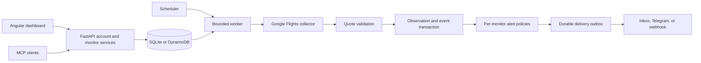

# Fareflare architecture

Fareflare separates a user's monitoring intent from price collection and alert
delivery. The API does not launch a browser. A scheduled worker collects due
shared targets, validates quotes, records observations, evaluates each subscriber's
rules, and delivers durable alerts.

## Boundaries and responsibilities

| Module or area | Responsibility |
| --- | --- |
| `contracts.py` | Immutable values and provider-independent contracts |
| `service.py` | Monitoring facade, lifecycle, collection, and event evaluation |
| `accounts.py`, `oauth.py`, `portal.py` | Account lifecycle, authorization, sessions, HTTP interface |
| `public_browser.py`, `public_quotes.py` | Browser lifecycle, supported capabilities, quote extraction and validation |
| `store.py` | SQLite and DynamoDB transactions, indexes, leases, retention |
| `outbox.py`, `webhooks.py`, `product_telegram.py` | Ordered durable delivery and channel adapters |
| `web/src/app/core/` | Typed API client, session state, and shared frontend contracts |
| `web/src/app/dashboard/` | Feature views and monitor presentation strategies |

Dependencies point from external adapters toward application contracts. Wire
concrete dependencies at CLI or Lambda startup. Keep provider parsing, persistence,
and notification transport out of pure policy decisions.

## Quote identity and price correctness

A URL is a provider locator, not sufficient comparison identity. A target preserves
journey slices, flight legs or search scope, dates, passengers, cabin and fare
requirements, market, and currency. Equivalent validated targets can share a check;
unknown encoded constraints must not be stripped merely to improve deduplication.

Only a quote matching the complete target becomes an observation. A selected
round-trip total must cover both directions. A two-adult total is read directly,
not calculated by multiplying a one-adult price. Basic Economy and a fare excluding
Basic are different comparisons. Prices use integer minor units with an explicit
currency; JPY does not use the same scale as USD.

`observed_at` means when Fareflare observed the offer. It does not establish when
an airline changed inventory. An observed low is the lowest accepted observation
since monitoring began. Polling cannot detect every change between checks.

The collector rejects unsupported inputs explicitly. See the
[supported-flight table](FAREFLARE.md) and redacted [provider research](research/).
Provider layout changes and transient failures retain the last validated quote
and expose stale/error state rather than replacing it with an unverified number.

## Patterns used deliberately

| Pattern | Use in Fareflare |
| --- | --- |
| Adapter | Browser evidence, database implementations, Telegram, and HTTP webhooks meet application contracts |
| Strategy | Alert policies and selected-itinerary versus route-search presentation vary behind common interfaces |
| Facade | API and MCP use the same monitoring operations |
| State | Explicit monitor and delivery transitions make repeated actions idempotent |
| Observer-style fan-out | One recorded quote produces independent subscriber decisions through persisted events |

The transactional outbox, ports and adapters, and Page Object are useful patterns,
but are not original Gang of Four patterns. Avoid a global browser Singleton,
deep collector inheritance, or class hierarchies without actual variation. One
bounded worker owns browser reuse and retry policy.

## Durability and isolation

Observation and event writes are atomic. The event processor evaluates each
monitor in sequence and creates durable deliveries. Only a monitor's queue head
can be sent; a failed head blocks its later alerts until retry or terminal handling.
Other monitors continue. Stable event IDs support receiver deduplication because a
crash after external acceptance can still produce a duplicate delivery.

Leases fence late workers. Strong reads make newly committed work available within
an invocation; indexed queries recover pending work after a restart. Tenant checks
protect account reads and mutations. Explicit webhook destinations never silently
fall back to Telegram.

## Cost and operational boundaries

Equivalent targets share collection and compatible targets reuse one anonymous
browser within a bounded batch. The worker resets page state between targets,
restarts failed sessions, and closes Chromium before delivery. The HTTP API remains
small and independently concurrency-limited.

Measure actual unique-target counts, browser duration, retries, storage, and
notification traffic before increasing quotas. Local speed measurements do not
establish AWS cost or a guaranteed polling interval. Follow the
[operations runbook](OPERATIONS.md) for deployment, alarms, and recovery.
